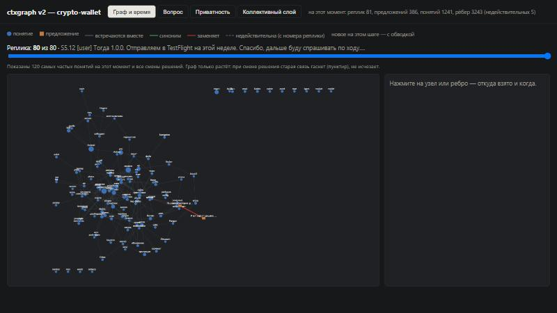
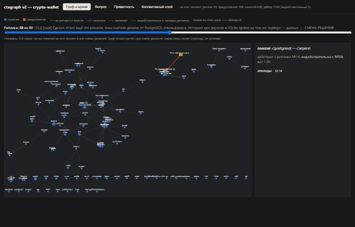
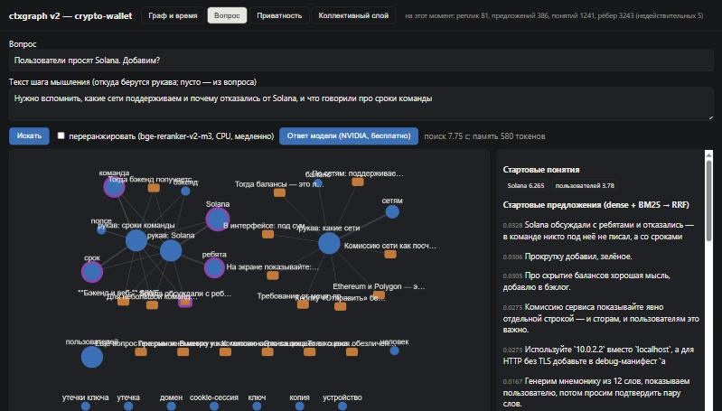

# Демо графа ctxgraph v2 (crypto-wallet)

## Запуск

```bash
.venv/Scripts/python scripts/v2_demo.py
```

- Открыть http://127.0.0.1:8765.
- Первый запуск строит граф за ~2–3 минуты на CPU: e5 для предложений.
- Дальше граф берётся из `.cache/demo/`. Пересобрать — `--rebuild`.
- Платных вызовов нет. Кнопка «Ответ модели» обращается к бесплатному NVIDIA API (Mistral Large 4, ключ из `.env`, только на сервере).

## Что видно

**1. Граф и время.**
- **Узлы:** понятия — кружки, предложения — прямоугольники.
- **Рёбра:**
  - серые — «встречаются в одном предложении»;
  - зелёные — синонимы;
  - красная стрелка — «заменяет»;
  - красный пунктир — недействительная связь, с номером реплики.
- **Клик по узлу** показывает, откуда он взят: предложения, эпизоды, номер реплики.
- **Ползунок по номеру реплики:** граф растёт, новые узлы обведены жёлтым. На реплике 38 (S3.2, «от PostgreSQL отказываемся») появляется ребро «заменяет» к S1.14, и 5 связей PostgreSQL гаснут в пунктир — они не удаляются.




**2. Вопрос.** Цепочка показана по шагам:
1. Стартовые понятия и стартовые предложения (dense + BM25 → RRF).
2. Рукава из текста шага мышления. Каждый рукав — группа слов, например «Solana», «какие сети», «сроки команды».
3. Мини-граф каждого рукава (PPR) с весами.
4. Пересечения рукавов — фиолетовые.
5. Блок памяти целиком и периферия.
6. По кнопке — ответ модели.



**3. Приватность.**
- Таблица отброшенного при записи: тип и позиция, без значения. В crypto-wallet фильтр ничего не нашёл.
- Поле для проверки своего текста — ничего не записывает. Пример: ключ, пароль и почта → `api_key`, `secret_assignment`, `email`.

**4.** Multi-user features are out of scope of this repository.

## Цифры (crypto-wallet, 81 реплика)

| показатель | значение |
|---|---|
| предложений | 386 |
| понятий | 1 241 |
| упоминаний | 2 260 |
| рёбер | 3 243, из них недействительных 5 |
| смен решения | 1 найдена детектором |
| построение графа | ~20 с на CPU с HashingEncoder; с e5 — ~1–2 мин |
| поиск, тёплый | 0,03–0,2 с на CPU (в бюджете 1–2 с) |
| первый запрос | ~7 с — строится матрица PPR; сервер прогревает её при старте |

## Что реализовано по `ARCHITECTURE_V2.md`

**Реализовано:**
- **§2 модель данных и §3.5 хранение:** SQLite в режиме WAL, FTS5 по леммам, би-временные рёбра, `supersedes`, `usage`. Код — `ctxgraph/v2/store.py`.
- **§3.1 эпизоды с провенансом.**
- **§3.2 извлечение:** наш извлекатель понятий. GLiNER для имён подключается флагом (`NameExtractor`); в демо выключен ради скорости.
- **§3.3 структура:** понятия и предложения, рёбра `contains` / `cooccur` / `synonym` / `next` / `replaces`.
- **§3.4 дозапись и недействительность.** Тест подтверждает инвариант: ни одного `DELETE`, а граф, достроенный после переоткрытия базы, совпадает с построенным за один проход.
- **§3.6 гибридный старт, §3.7 PPR, §3.8 отбор** (cross-encoder — по галочке).
- **§3.9 рукава:** мини-графы, пересечения, периферия.
- **§3.10:** только интерфейс `record_usage`.
- **§3.11:** наш фильтр до записи, везде.

**Ещё нет:**
- Presidio на русском (§3.11).
- Привязка к Wikidata, офлайн-индекс (§3.13) — QID в демо пустые.
- Английский путь spaCy и проверка на 30 абзацах MuSiQue (§3.2).
- Замер лёгких переранжировщиков (§3.8).
- MCP-инструменты и хуки (§3.14).
- Калибровка порога синонимов на размеченных парах (§3.3). Порог 0,965 временный: при 0,90 получилось 108 тыс. «синонимов».

## Замечания по демо

- Детектор смены решения по-прежнему ловит мало: в crypto-wallet одна смена.
- Ответ модели на «Пользователи просят Solana. Добавим?» отказ от Solana не упомянул, хотя реплика об отказе была первой в блоке памяти. Это вопрос подачи и модели, не графа; выводы — только на чужих бенчмарках.
